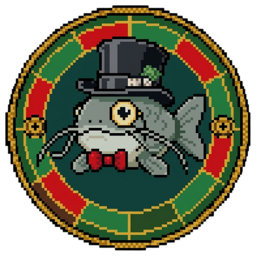
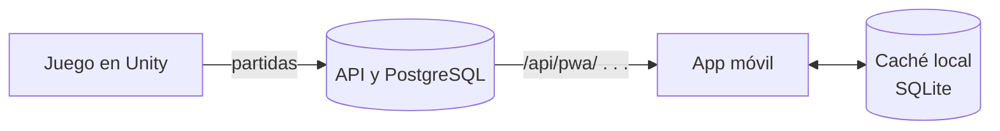
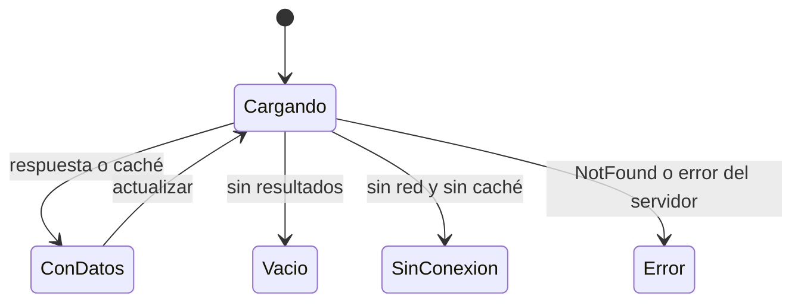

# Fat Fish – App móvil del videojuego

[](https://github.com/Anuma-Games/fat-fish-mobile/actions/workflows/ci.yml)

<p align="center"></p>

App en Flutter del proyecto integrador **Fat Fish**, del equipo Anuma Games (IDGS101N, Universidad Tecnológica de
Chihuahua). Consume la API del proyecto ([fat-fish-api](https://github.com/Anuma-Games/fat-fish-api)). Este documento
reúne la propuesta de la app y el estado actual de su construcción.

## Contenido

1. [Propósito](#1-propósito)
2. [Estado actual](#2-estado-actual)
3. [Cómo ejecutarla](#3-cómo-ejecutarla)
4. [Arquitectura](#4-arquitectura)
5. [Consumo de API](#5-consumo-de-api)
6. [Sin conexión](#6-sin-conexión)
7. [Experiencia de usuario](#7-experiencia-de-usuario)
8. [Integración continua y flujo de trabajo](#8-integración-continua-y-flujo-de-trabajo)
9. [Equipo](#9-equipo)

---

## 1. Propósito

Fat Fish es un videojuego de ruleta que trata el tema de la **ludopatía**. La app lleva al teléfono el expediente *"Lo
que el casino sabe de ti"*: las estadísticas e historial del jugador presentados como el perfil que un casino construye
de sus clientes. También permite buscar a otros jugadores y consultar el ranking mundial.

La app solo lee datos: no registra jugadores ni partidas y no pide iniciar sesión. El jugador se identifica con su **ID
público**. La retroalimentación y la encuesta se quedan en la PWA.

## 2. Estado actual

| Función                                            | Estado        |
|----------------------------------------------------|---------------|
| Base: estructura, configuración, navegación y tema | ✅ Construido |
| Mi jugador y búsqueda por alias o ID               | ✅ Construido |
| Expediente e historial                             | ✅ Construido |
| Ranking mundial                                    | ✅ Construido |
| Bienvenida y barra de navegación con gesto         | ✅ Construido |
| La mesa, ajustes y sonido                          | ✅ Construido |
| Consulta sin conexión                              | ✅ Construido |
| APK publicado                                      | ⏳ Pendiente  |

## 3. Cómo ejecutarla

Requiere Flutter 3.47.7 (canal stable); para el APK, Android SDK y Java 17.

| Comando                                                 | Uso                                       |
|---------------------------------------------------------|-------------------------------------------|
| `flutter run --dart-define-from-file=config/local.json` | Correr en un emulador o dispositivo       |
| `flutter test`                                          | Pruebas                                   |
| `flutter analyze`                                       | Análisis estático                         |
| `dart run build_runner build`                           | Regenerar el código de Drift (`*.g.dart`) |
| `flutter build apk`                                     | Generar el APK                            |

**Configuración.** La URL y la llave de la API se leen al compilar, así que cambian sin tocar el código. Copia
`config/example.json` a `config/local.json` (ignorado por Git):

| Clave                | Valor                                                                      | Por defecto                                                             |
|----------------------|----------------------------------------------------------------------------|-------------------------------------------------------------------------|
| `API_BASE_URL`       | Dirección de la API, sin `/` final                                         | `http://10.0.2.2:8080`: la API local vista desde el emulador de Android |
| `API_KEY`            | Llave de la cabecera `X-Api-Key`; se pide al responsable de la API         | Vacía (la API local no la pide)                                         |
| `SENTRY_DSN`         | DSN del proyecto `fat-fish-mobile` en Sentry (errores y rendimiento)       | Vacío: Sentry desactivado (pruebas y CI)                                |
| `SENTRY_ENVIRONMENT` | Ambiente que se muestra en Sentry (`development`, `staging`, `production`) | `development`                                                           |
| `SENTRY_TEST_BUTTON` | `true` muestra un botón que lanza un error de prueba para verificar Sentry | `false`                                                                 |

- El HTTP sin cifrar solo se permite en depuración. En un iPhone conviene usar la API en `https`.
- La llave queda dentro del APK y se puede extraer, así que solo debe abrir endpoints de lectura pública.
- En macOS, el proyecto no debe estar en una carpeta sincronizada con iCloud: la firma de iOS falla.

## 4. Arquitectura



El código se organiza por *feature* y, dentro de cada una, en las capas de *clean architecture*:

```text
lib/
├── main.dart                 # raíz de composición: crea los servicios y los entrega con RepositoryProvider
├── app/                      # FatFishApp, tema, rutas y barra de navegación
├── core/                     # config, ApiClient, AppDatabase, tokens de diseño y widgets comunes
└── features/                 # ajustes, bienvenida, expediente, jugador, mesa y ranking
    └── <feature>/
        ├── data/             # DTOs, fuentes de datos (API y caché) e implementación del repositorio
        ├── domain/           # entidades, repositorio abstracto y casos de uso
        └── presentation/     # páginas, widgets y Cubits
```

```text
Página → Cubit → Caso de uso → Repositorio (domain) ← Implementación (data) → API / Drift
```

- `domain` no importa nada de `data`, de Flutter ni de paquetes externos.
- Cada caso de uso es una clase con un solo método `call`; el `Cubit` de cada pantalla lo llama.
- Las pruebas replican las rutas de `lib/` dentro de `test/`.

| Paquete                 | Uso                                                              |
|-------------------------|------------------------------------------------------------------|
| `flutter_bloc`          | Estado con Cubits e inyección con `RepositoryProvider`           |
| `go_router`             | Rutas; cada pestaña conserva su historial (`StatefulShellRoute`) |
| `http`                  | Cliente de la API                                                |
| `drift`                 | Caché local en SQLite                                            |
| `bloc_test`, `mocktail` | Pruebas                                                          |

## 5. Consumo de API

| Endpoint                                    | Uso                                  | Estado        |
|---------------------------------------------|--------------------------------------|---------------|
| `GET /api/pwa/perfil?id=`                   | Datos del jugador y sus estadísticas | ✅ Disponible |
| `GET /api/pwa/partidas?id=&pagina=&tamano=` | Historial paginado                   | ✅ Disponible |
| `GET /api/pwa/jugadores?busqueda=`          | Búsqueda por alias o ID              | ✅ Disponible |
| `GET /api/pwa/ranking?pagina=&jugadorId=`   | Top 50 y la posición propia          | ✅ Disponible |

`ApiClient` envía `X-Api-Key` y convierte cada falla en una excepción que la pantalla muestra:

| Respuesta               | Excepción                     | Qué ve el jugador                         |
|-------------------------|-------------------------------|-------------------------------------------|
| Sin red o sin respuesta | `NetworkException`            | Los últimos datos guardados               |
| `404`                   | `NotFoundException`           | "No encontramos lo que buscabas"          |
| Otro `4xx`              | `SomethingWentWrongException` | Error nuestro (llave o petición inválida) |
| `3xx` o `5xx`           | `ServerException`             | "No pudimos cargar los datos"             |
| `2xx` con otro formato  | `UnexpectedResponseException` | Error nuestro (contrato distinto)         |

## 6. Sin conexión

`CachedApi` guarda en SQLite ([Drift](https://drift.simonbinder.eu/)) la última respuesta del expediente, el historial
y el ranking (tabla `cached_responses`, una fila por petición). Si la red falla (`NetworkException`), devuelve esa copia
con su fecha y la pantalla muestra el aviso "Sin conexión": "Datos guardados el 3 de noviembre, 2026, a las 18:42.
Pueden estar desactualizados." Un `404` o un error del servidor no usan la copia. Sin conexión, el historial muestra las
partidas guardadas y "Ver más" vuelve cuando hay red. La búsqueda de jugadores siempre necesita conexión.

Cada feature agrega sus tablas a `lib/core/storage/app_database.dart`; un cambio de esquema sube `schemaVersion` con su
migración.



## 7. Experiencia de usuario

La app sigue el diseño de [Fat Fish - App móvil](https://claude.ai/artifact/PKb3b1jTvdyMvX6TVU9Sr8): fondo con el
patrón de rombos, barra superior oscura e íconos pixel art de 12 × 12 (`PixelIcon`). Lo que el casino sabe del jugador
va en una hoja de papel (`RuledPaper`, `PaperText`).

Sin jugador guardado la app abre la **Bienvenida**. Con jugador, abre el expediente. Abajo flota la barra con tres
fichas, **Expediente**, **Mesa** y **Ranking**, que cambian al tocarlas o al deslizar el dedo sobre la barra. Las dos
barras se
ocultan al bajar y vuelven al subir. **Mi jugador** se abre desde "Cambiar" en el expediente. Los valores están en
`lib/core/theme/tokens.dart`, y
`lib/app/theme/app_theme.dart` los aplica a los componentes de Material, así que las pantallas no escriben colores ni
medidas.

| Uso              | Valor                                                                                                                                          |
|------------------|------------------------------------------------------------------------------------------------------------------------------------------------|
| Fondo y tarjetas | `#0B1416` y `#172A25`                                                                                                                          |
| Paño             | `#0D3522` y `#105030`                                                                                                                          |
| Dorado           | `#E8B850`, para las acciones                                                                                                                   |
| Rojo             | `#B3261E`, el único: pérdida, derrota y peligro; como texto solo sobre papel                                                                   |
| Texto            | `#F2E8CC` y `#9AA8A2`                                                                                                                          |
| Papel y tinta    | `#E6DCC3` y `#231E17`                                                                                                                          |
| Fuentes          | **Jersey 10** (títulos, botones y cifras), **Jersey 15** (lectura y datos destacados), **Fat Fish Pixel** (etiquetas) y **Courier Prime** (papel), en `assets/fonts/` con su licencia OFL |

**Fat Fish Pixel** es Press Start 2P con las mayúsculas acentuadas (Á É Í Ó Ú Ñ Ü) a altura completa, como la fuente
`fat-fish-acentos` de la PWA: en la original parecen minúsculas. Se genera con
`python -I tool/fuente_pixel.py assets/fonts/PressStart2P-Regular.ttf` (requiere fontTools) y lleva otro nombre porque
"Press Start 2P" es un nombre reservado de su licencia.

**La mesa** tiene una ruleta para girar mientras se espera: no cambia el expediente. Cuenta los giros y el tiempo de
la visita, muestra los últimos números y el crupier dice una frase tras cada giro. **Ajustes** se abre con el engrane
de la barra superior y guarda en el teléfono el ambiente de fondo, los sonidos de la mesa, el volumen (10 niveles) y la
vibración; la bocina de la barra enciende y apaga el ambiente. El sonido empieza apagado, se pausa cuando la app pasa a segundo plano y, con "reducir
movimiento", la ruleta da el resultado sin animación.

El fondo visual de la mesa (`assets/images/mesa.jpg`) se exporta desde el escenario actual de Unity,
sin HUD y con el encuadre original del juego: conserva al crupier, la mesa y el local.
El exportador ejecuta el constructor de ruleta de la partida antes de renderizar, para incluir
el tazón y las casillas actuales en lugar del modelo antiguo de la escena guardada.
La app mantiene el recorte anterior, con un degradado más ligero para mostrar mejor al crupier;
la altura del fondo acompaña la escala
de la ruleta para que la foto no quede detrás de los resultados en teléfonos más bajos.
La exportación se documenta en [`tool/unity/README.md`](tool/unity/README.md).

El fondo musical es una exportación instrumental de `GameSynth.cs`, el sintetizador de la mesa del juego:
jazz nocturno a 86 BPM, con bajo caminante, acordes con swing, escobillas y vibráfono. Usa la versión tranquila
(tensión 0, sin jefe), sin conversaciones ni grabaciones de bares. El bucle dura 44.651 segundos, cuatro vueltas
de la progresión Am7–Dm7–Bbmaj7–E7(b9).

Para exportar solo la música: `python3 -I tool/render_gamesynth.py`. Requiere .NET SDK 8+ y el repositorio
hermano `fat-fish-game`; se puede indicar otra ruta con `--source /ruta/GameSynth.cs`. Se ejecuta el callback
C# original con un adaptador mínimo, sin abrir Unity ni modificar el juego. Los créditos están en
`assets/sonidos/CREDITS.md`.

La ruleta usa las mismas grabaciones del juego (`assets/sonidos/roulette/`): lanzamiento, rodado,
14 golpes. Se copian sin procesar con `python3 -I tool/import_roulette.py`,
desde `fat-fish-game/Assets/Resources/Audio/Roulette`; acepta otra ruta con `--source`.
El roce del borde usa `roll.wav` con un nivel suave y su tono natural, sin barrido de velocidad;
se desvanece durante la bajada y se detiene al llegar a las casillas. Conserva el lanzamiento breve y los golpes individuales,
con variaciones ligeras de tono y sin repetir inmediatamente la misma toma. Al entrar en su casilla
definitiva se detiene el rodado y se reproduce un único golpe del mismo banco, junto con la vibración; no se añade
un clic al terminar la animación.

Para exportar música, importar la ruleta y regenerar el encendido de la lámpara:
`python3 -I tool/sonidos_mesa.py` (requiere .NET SDK 8+ y el código del juego).
SoLoud (`flutter_soloud`) aplica los 10 niveles guardados como volumen
maestro, también a los sonidos en curso, y limita los picos de la mezcla a −1 dBFS. Al pasar a segundo plano se
detienen todos los sonidos, incluidos los efectos cortos; al volver se recupera el ambiente si estaba activado.

El logo aprobado está en `assets/icon/source/fat_fish_logo.png`. `tool/generate_logo.dart` exporta el mismo
logo para la app, el README y las pantallas de arranque Android/iOS, y regenera los iconos de instalación.
La app y el README usan una exportación de 512 px; las reducciones promedian los píxeles para suavizar
los bordes. El original se conserva para regenerar los recursos y el icono adaptativo.
Para actualizarlo, reemplaza el archivo fuente y ejecuta desde la raíz del repositorio:

```bash
dart run tool/generate_logo.dart
```

Los iconos de instalación se generan desde `assets/icon/`, con fondo `#0B1416`. El icono adaptativo Android
usa un margen de 20 % para mantener el emblema completo al aplicar distintas máscaras del launcher.

La barra inferior reproduce una ficha del juego al confirmar otra sección por toque o al soltar
un gesto. Tocar la sección activa la regresa a su primera pantalla sin sonido; previsualizar otra
ficha o cancelar el gesto no cambia la sección ni añade sonido. La ficha respeta **Sonidos de la mesa**, el volumen y la pausa de la app.
Se exporta desde `GameSynth.cs` con `python3 -I tool/render_navigation_chip.py` (.NET SDK 8+ y
el checkout hermano del juego); receta y créditos en [`NAVEGACION.md`](assets/sonidos/NAVEGACION.md).

## 8. Integración continua y flujo de trabajo

GitHub Actions ([`ci.yml`](.github/workflows/ci.yml)) corre en cada Pull Request y en cada cambio a `develop` y `main`:

1. **Analizar y probar:** formato, análisis estático y pruebas.
2. **Compilar APK:** APK de depuración como artefacto `fat-fish-mobile-apk`.

- Ramas: `main` (producción), `develop` (integración) y `feature/FF-<ticket>-<descripción>`. Las dos principales están
  protegidas.
- Todo cambio entra por Pull Request con una aprobación y el CI en verde; `CODEOWNERS` asigna a los revisores y la
  plantilla pide el ticket de Jira.
- Dependabot propone cada semana las actualizaciones de dependencias.

## 9. Equipo

**Anuma Games** – Proyecto integrador, grupo IDGS101N, Universidad Tecnológica de Chihuahua

- Luis Ángel Gaxiola Gamboa
- Emmanuel González Hernández
- Jesús Antonio Jiménez Mendoza
- Ángel Gael Jurado Rodríguez
- Andrik Rivera Esquer

## Descargas y almacenamiento de CI

La última compilación comprobada de `main` se conserva en Releases sin caducidad.
Consulta la [política de descargas y limpieza automática](.github/ARTIFACTS.md) para conocer
los archivos disponibles, la retención temporal en Actions y cómo previsualizar la limpieza.
