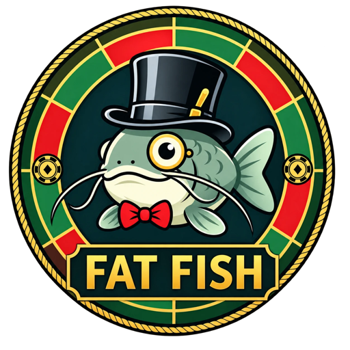
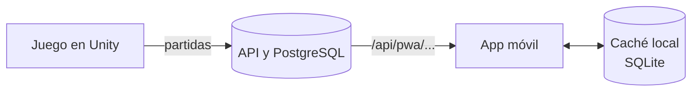
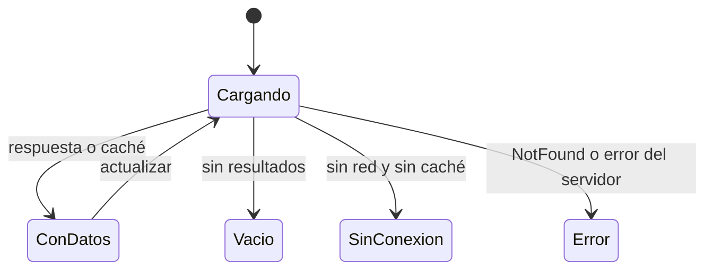

# Fat Fish – App móvil del videojuego

[](https://github.com/Anuma-Games/fat-fish-mobile/actions/workflows/ci.yml)

<p align="center"></p>

App en Flutter del proyecto integrador **Fat Fish**, del equipo Anuma Games (IDGS101N, Universidad Tecnológica de
Chihuahua). Consume la API del proyecto ([fat-fish-api](https://github.com/Anuma-Games/fat-fish-api)). Este documento
reúne la propuesta de la app y el estado actual de su construcción.

## Contenido

1. [Propósito](#1-propósito)
2. [Estado actual](#2-estado-actual)
3. [Cómo ejecutarla](#3-cómo-ejecutarla)
4. [Arquitectura](#4-arquitectura)
5. [Consumo de API](#5-consumo-de-api)
6. [Sin conexión](#6-sin-conexión)
7. [Experiencia de usuario](#7-experiencia-de-usuario)
8. [Integración continua y flujo de trabajo](#8-integración-continua-y-flujo-de-trabajo)
9. [Equipo](#9-equipo)

---

## 1. Propósito

Fat Fish es un videojuego de ruleta que trata el tema de la **ludopatía**. La app lleva al teléfono el expediente *"Lo
que el casino sabe de ti"*: las estadísticas e historial del jugador presentados como el perfil que un casino construye
de sus clientes. También permite buscar a otros jugadores y consultar el ranking mundial.

La app solo lee datos: no registra jugadores ni partidas y no pide iniciar sesión. El jugador se identifica con su **ID
público**. La retroalimentación y la encuesta se quedan en la PWA.

## 2. Estado actual

| Función                                            | Estado        |
|----------------------------------------------------|---------------|
| Base: estructura, configuración, navegación y tema | ✅ Construido |
| Mi jugador y búsqueda por alias o ID               | ⏳ Pendiente  |
| Expediente e historial                             | ⏳ Pendiente  |
| Ranking mundial                                    | ⏳ Pendiente  |
| Consulta sin conexión                              | ⏳ Pendiente  |
| APK publicado                                      | ⏳ Pendiente  |

## 3. Cómo ejecutarla

Requiere Flutter 3.47.7 (canal stable); para el APK, Android SDK y Java 17.

| Comando                                                 | Uso                                       |
|---------------------------------------------------------|-------------------------------------------|
| `flutter run --dart-define-from-file=config/local.json` | Correr en un emulador o dispositivo       |
| `flutter test`                                          | Pruebas                                   |
| `flutter analyze`                                       | Análisis estático                         |
| `dart run build_runner build`                           | Regenerar el código de Drift (`*.g.dart`) |
| `flutter build apk`                                     | Generar el APK                            |

**Configuración.** La URL y la llave de la API se leen al compilar, así que cambian sin tocar el código. Copia
`config/example.json` a `config/local.json` (ignorado por Git):

| Clave          | Valor                                                              | Por defecto                                                             |
|----------------|--------------------------------------------------------------------|-------------------------------------------------------------------------|
| `API_BASE_URL` | Dirección de la API, sin `/` final                                 | `http://10.0.2.2:8080`: la API local vista desde el emulador de Android |
| `API_KEY`      | Llave de la cabecera `X-Api-Key`; se pide al responsable de la API | Vacía (la API local no la pide)                                         |

- El HTTP sin cifrar solo se permite en depuración. En un iPhone conviene usar la API en `https`.
- La llave queda dentro del APK y se puede extraer, así que solo debe abrir endpoints de lectura pública.
- En macOS, el proyecto no debe estar en una carpeta sincronizada con iCloud: la firma de iOS falla.

## 4. Arquitectura



El código se organiza por *feature* y, dentro de cada una, en las capas de *clean architecture*:

```text
lib/
├── main.dart                 # raíz de composición: crea los servicios y los entrega con RepositoryProvider
├── app/                      # FatFishApp, tema, rutas y barra de navegación
├── core/                     # config, ApiClient, AppDatabase, tokens de diseño y widgets comunes
└── features/                 # expediente, jugador y ranking
    └── <feature>/
        ├── data/             # DTOs, fuentes de datos (API y caché) e implementación del repositorio
        ├── domain/           # entidades, repositorio abstracto y casos de uso
        └── presentation/     # páginas, widgets y Cubits
```

```text
Página → Cubit → Caso de uso → Repositorio (domain) ← Implementación (data) → API / Drift
```

- `domain` no importa nada de `data`, de Flutter ni de paquetes externos.
- Cada caso de uso es una clase con un solo método `call`; el `Cubit` de cada pantalla lo llama.
- Las pruebas replican las rutas de `lib/` dentro de `test/`.

| Paquete                 | Uso                                                              |
|-------------------------|------------------------------------------------------------------|
| `flutter_bloc`          | Estado con Cubits e inyección con `RepositoryProvider`           |
| `go_router`             | Rutas; cada pestaña conserva su historial (`StatefulShellRoute`) |
| `http`                  | Cliente de la API                                                |
| `drift`                 | Caché local en SQLite                                            |
| `bloc_test`, `mocktail` | Pruebas                                                          |

## 5. Consumo de API

| Endpoint                                    | Uso                                  | Estado        |
|---------------------------------------------|--------------------------------------|---------------|
| `GET /api/pwa/perfil?id=`                   | Datos del jugador y sus estadísticas | ✅ Disponible |
| `GET /api/pwa/partidas?id=&pagina=&tamano=` | Historial paginado                   | ✅ Disponible |
| `GET /api/pwa/jugadores?busqueda=`          | Búsqueda por alias o ID              | ⏳ Pendiente  |
| `GET /api/pwa/ranking?pagina=&jugadorId=`   | Top 50 y la posición propia          | ⏳ Pendiente  |

`ApiClient` envía `X-Api-Key` y convierte cada falla en una excepción que la pantalla muestra:

| Respuesta               | Excepción                     | Qué ve el jugador                         |
|-------------------------|-------------------------------|-------------------------------------------|
| Sin red o sin respuesta | `NetworkException`            | Los últimos datos guardados               |
| `404`                   | `NotFoundException`           | "No encontramos lo que buscabas"          |
| Otro `4xx`              | `SomethingWentWrongException` | Error nuestro (llave o petición inválida) |
| `3xx` o `5xx`           | `ServerException`             | "El servidor no pudo responder"           |

## 6. Sin conexión

La caché en SQLite ([Drift](https://drift.simonbinder.eu/)) es la única fuente de los datos en pantalla: la red solo la
actualiza. Sin conexión se muestran los últimos datos con el aviso "Sin conexión" y su fecha. Cada feature agrega sus
tablas a `lib/core/storage/app_database.dart`; un cambio de esquema sube `schemaVersion` con su migración.



## 7. Experiencia de usuario

La app usa la guía de estilo de la PWA: fondo con el patrón de rombos, barras de paño con borde dorado e íconos pixel
art de 12 × 12 (`PixelIcon`). Tiene tres pestañas: **Expediente**, **Ranking** y **Mi jugador**. Los valores están en
`lib/core/theme/tokens.dart` con los mismos nombres que `tokens.css`, y `lib/app/theme/app_theme.dart` los aplica a los
componentes de Material, así que las pantallas no escriben colores ni medidas.

| Uso                | Valor                                                                                                               |
|--------------------|---------------------------------------------------------------------------------------------------------------------|
| Fondo y tarjetas   | `#0B1416` y `#172A25`                                                                                               |
| Paño (barras)      | `#0D3522` y `#105030`                                                                                               |
| Dorado             | `#E8B850`                                                                                                           |
| Victoria / derrota | `#6FD39A` / `#882020` (ficha) y `#F08A7E` (cifras)                                                                  |
| Texto              | `#F2E8CC` y `#9AA8A2`                                                                                               |
| Fuentes            | **Jersey 10** (títulos), **Press Start 2P** (etiquetas) y **Geist** (texto), en `assets/fonts/` con su licencia OFL |

El ícono de la app sale de `assets/icon/` y se regenera con `dart run flutter_launcher_icons`.

## 8. Integración continua y flujo de trabajo

GitHub Actions ([`ci.yml`](.github/workflows/ci.yml)) corre en cada Pull Request y en cada cambio a `develop` y `main`:

1. **Analizar y probar:** formato, análisis estático y pruebas.
2. **Compilar APK:** APK de depuración como artefacto `fat-fish-mobile-apk`.

- Ramas: `main` (producción), `develop` (integración) y `feature/FF-<ticket>-<descripción>`. Las dos principales están
  protegidas.
- Todo cambio entra por Pull Request con una aprobación y el CI en verde; `CODEOWNERS` asigna a los revisores y la
  plantilla pide el ticket de Jira.
- Dependabot propone cada semana las actualizaciones de dependencias.

## 9. Equipo

**Anuma Games** – Proyecto integrador, grupo IDGS101N, Universidad Tecnológica de Chihuahua

- Luis Ángel Gaxiola Gamboa
- Emmanuel González Hernández
- Jesús Antonio Jiménez Mendoza
- Ángel Gael Jurado Rodríguez
- Andrik Rivera Esquer
